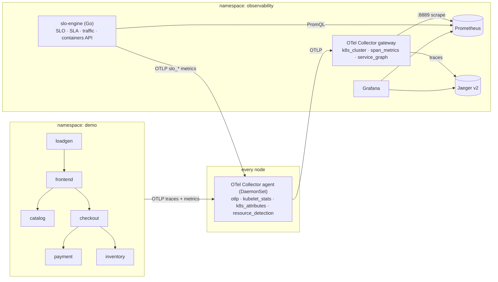

# otel-slo-traffic-monitor

[](https://github.com/seshikanthguduri/otel-slo-traffic-monitor/actions/workflows/ci.yaml)

SLO and SLA tracking for Kubernetes microservices, at the container level, built on OpenTelemetry. Runs on minikube in about 10 minutes. The same manifests target EKS, GKE and AKS through kustomize overlays.

It answers four questions that usually take four tools:

1. **Are we meeting our SLOs, and how fast are we burning error budget?** Multi-window, multi-burn-rate evaluation, per the Google SRE Workbook.
2. **Are we meeting the contract (SLA), and what do we owe in service credits?**
3. **Which service-to-service call is hurting us?** A live dependency graph built from traces, with hot edges flagged and the blast radius computed for every service.
4. **Is the problem in the code or the container?** CPU and memory as a share of limits, plus restarts, joined to request rate, error rate and p99 for each pod.



## What's in the box

| Component | What it does |
|---|---|
| `cmd/demo-service` | One Go binary that plays any microservice. It's instrumented with the OTel SDK and `otelhttp`, uses W3C trace-context propagation, and lets you inject faults at runtime through `POST /admin/fault`. |
| `cmd/loadgen` | Steady, traced traffic. It shows up as the root node of the service graph. |
| `cmd/slo-engine` | Evaluates SLOs and SLAs, analyses traffic and joins container health. Serves a JSON API and exports its results as OTel metrics. It also generates Prometheus alert rules. |
| OTel Collector agent | DaemonSet. Runs `kubelet_stats` (container, pod and node CPU and memory, including limit and request utilization), `k8s_attributes` and `resource_detection`. Apps reach it through a node-local Service (`internalTrafficPolicy: Local`), so no hostPort is needed. |
| OTel Collector gateway | Runs `k8s_cluster` (restarts, readiness, deployment health), the `span_metrics` connector (RED metrics from spans) and the `service_graph` connector (client→server edges). Fans out to backends. |
| Prometheus, Grafana, Jaeger | Local backends. In the cloud overlays you swap them for managed services. |

The pipeline uses only standard OTel pieces: OTLP, semantic-convention HTTP metrics (`http.server.request.duration`), and spec-defined `OTEL_*` environment variables. Nothing in the Go code is cloud-specific.

## Quick start (minikube)

Prerequisites: `minikube` (docker driver), `kubectl`, `make`, `curl`, `jq`. Budget roughly 4 CPUs and 8 GB RAM.

```bash
git clone https://github.com/seshikanthguduri/otel-slo-traffic-monitor.git
cd otel-slo-traffic-monitor

make minikube-up      # minikube start --cpus=4 --memory=8192
make image            # docker build + minikube image load, no registry needed
make deploy           # kubectl apply -k deploy/overlays/minikube
make wait             # waits for every rollout
make port-forward     # Grafana :3000, Prometheus :9090, Jaeger :16686, SLO API :8081
```

Wait 2 to 3 minutes for data to arrive, then:

```bash
curl -s localhost:8081/api/v1/summary | jq          # what's breached, what's paging, hot edges, saturated pods
curl -s localhost:8081/api/v1/traffic/mermaid       # paste into any Markdown that renders Mermaid
curl -s localhost:8081/api/v1/containers | jq       # per-container CPU/mem vs limits + RED
```

### Break something on purpose

```bash
make chaos     # payment -> 30% 5xx, catalog -> 20% slow tail
# ~2 minutes later:
curl -s localhost:8081/api/v1/slos/payment-availability | jq '.alerts[] | select(.firing)'
curl -s localhost:8081/api/v1/sla | jq '.[] | {name, state: .sla.state, credit: .sla.credit_percent}'
make heal
```

Watch the `SLO, SLA and Service Traffic` dashboard in Grafana while this runs. The payment error ratio moves first, the checkout→payment edge turns hot, frontend availability burns next (that's the blast radius), and the payment SLA flips to `BREACHED`. Prometheus fires `SLOErrorBudgetBurn` at `localhost:9090/alerts` on its own, without the engine.

### Run the automated end-to-end test

```bash
make e2e
```

This checks that traces reach Jaeger, that all five service-graph edges appear, and that all six SLOs evaluate with data. It confirms the kubelet_stats and k8s_cluster container metrics exist, that the container view joins resource and RED data, and that the engine's own metrics arrive over OTLP. Then it injects faults and asserts that the payment SLO pages, that the SLA reports `BREACHED`, and that the checkout→payment edge is flagged. CI runs the same script on a fresh minikube for every push (see `.github/workflows/ci.yaml`).

## The SLO config

`deploy/base/slo-engine/slo-config.yaml` holds the whole catalogue. Here's one entry:

```yaml
- name: payment-availability
  service: payment
  objective: 0.9995          # internal SLO
  window: 30d
  sli:
    template: http-availability
    selector: k8s_namespace_name="demo"
  sla:
    target: 0.999            # contract; must be looser than the SLO
    credits:
      - {below: 0.999, percent: 10}
      - {below: 0.995, percent: 30}
```

SLI templates:

| Template | Good events | Source |
|---|---|---|
| `http-availability` | non-5xx requests | `http_server_request_duration_seconds_count` |
| `http-latency` | requests under `latencyThreshold` (must be a histogram bucket boundary) | `..._bucket{le=...}` |
| `service_graph-edge-availability` | non-failed calls on one client→server edge | `traces_service_graph_request_*` |
| `custom` | your own `errorQuery` / `totalQuery` with `{{window}}` | any PromQL |

When `alertPolicies` is omitted you get the SRE Workbook defaults: 2% of budget burned in 1h (paired with 5m) pages, 5% in 6h (paired with 30m) pages, 10% in 1d and 10% in 3d open tickets. On a 30-day window those come out to the familiar 14.4, 6, 3 and 1 burn-rate thresholds, and they scale correctly for 7-day or 28-day windows. An alert fires only when both its long and short windows exceed the threshold. The long window shows the burn is significant, and the short one lets the alert reset quickly once things recover.

`make rules` turns the same file into Prometheus recording and alerting rules. Paging still works even if the engine is down. `slo-engine rules -format prometheusrule` emits a prometheus-operator `PrometheusRule` instead. CI fails if the committed rules drift from the config.

## Engine API

| Endpoint | Returns |
|---|---|
| `GET /api/v1/summary` | Breached SLOs, firing pages and tickets, SLAs at risk or breached, hot edges, saturated containers |
| `GET /api/v1/slos`, `/api/v1/slos/{name}` | SLI, budget remaining (as a fraction and in minutes), burn rate per window, alert states |
| `GET /api/v1/sla` | Contract view: state (`MET` / `AT_RISK` / `BREACHED`) and credit percent |
| `GET /api/v1/traffic?window=5m` | Nodes (callers, callees, blast radius, entrypoint) and edges (rps, error ratio, p50 and p99, hot reasons) |
| `GET /api/v1/traffic/mermaid`, `/dot` | The same graph for docs or Graphviz |
| `GET /api/v1/containers` | Per-container CPU and memory against limits, restarts, and the pod's RPS, error ratio and p99 |

CLI:

```bash
slo-engine validate -config slo-config.yaml
slo-engine report   -config slo-config.yaml --fail-on-page   # exit 2 if paging: a release gate for CD pipelines
slo-engine rules    -config slo-config.yaml > slo-rules.yaml
```

## Other clouds

| Overlay | Resource detection | Metrics backend | Identity |
|---|---|---|---|
| `minikube` | env, system | in-cluster Prometheus | n/a |
| `eks` | env, eks, ec2 | Amazon Managed Service for Prometheus (remote write + `sigv4auth`) | IRSA / EKS Pod Identity |
| `gke` | env, gcp | Google Cloud Managed Service for Prometheus (`googlemanagedprometheus`) | Workload Identity |
| `aks` | env, aks, azure | Azure Monitor managed Prometheus (ama-metrics scrape config) | add-on managed |

Each overlay changes only a small `cloud.yaml` that the Collector merges over the base config (`--config base.yaml --config cloud.yaml`), plus image, identity and cluster-name patches. Look for `REPLACE_ME` in the overlay you choose. The engine speaks the plain Prometheus HTTP API, so you can point `PROMETHEUS_URL` at Thanos, Mimir, VictoriaMetrics or a managed endpoint, and tenant or auth headers go in `prometheus.headers`.

## What has been verified, and how

- Unit tests cover the burn-rate math (including the 14.4/6/3/1 thresholds), SLA states and credit tiers, config validation, PromQL generation, graph analysis (hot edges, blast radius, cycles), the container join and every API route. They run with `-race` in CI.
- The full pipeline was run against real `otelcol-contrib` 0.162.0 and Prometheus 3.15.0 binaries. The metric names the engine and dashboard query (`http_server_request_duration_seconds_*`, `traces_service_graph_*`, `slo_*`, `sla_*`) were confirmed against live data.
- `kustomize build` passes for all four overlays, and `kubeconform -strict` validates the output. Collector configs pass `otelcol validate`, and the generated rules pass `promtool check rules`.
- `govulncheck` is clean.
- The kubelet_stats and k8s_cluster metric names are asserted by the minikube e2e job, which needs a real kubelet. If a Collector upgrade renames one, that job fails and lists the actual names in its artifacts.

Known limitation: Jaeger 2.21 and later removed the legacy `/api/services` and `/api/traces?service=` endpoints and kept `/api/v3/*` and trace-by-ID. Search traces in the Jaeger UI (`localhost:16686`). From Grafana, open traces by ID or through exemplars. If Grafana's Jaeger search returns 404, this is the reason.

Not tested here: live EKS, GKE and AKS clusters. Those overlays are validated for schema and Collector config, but you need to fill in your account, workspace and identity values.

## Repository layout

```
cmd/                 demo-service, loadgen, slo-engine
internal/telemetry   OTel SDK bootstrap (OTLP, W3C propagation, resource detection)
internal/slo         config, budget/burn-rate math, SLA, engine, rule generator
internal/traffic     service-graph analysis, Mermaid/DOT rendering
internal/containers  container resource + RED join
internal/prom        minimal Prometheus HTTP API client
internal/api         HTTP API
deploy/base          cloud-neutral manifests and configs
deploy/overlays      minikube, eks, gke, aks
scripts/             wait-ready, port-forward, chaos, e2e
docs/ARCHITECTURE.md design decisions and production scale-out
```

## License

Apache-2.0
